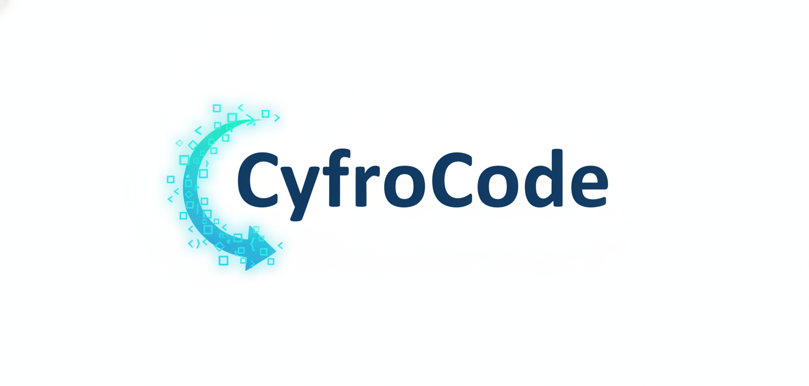

# CyfroCode — a ready-to-run OpenCode agent


This repository gives you a fully configured [OpenCode](https://opencode.ai) coding agent
that runs on models hosted by the [PLGrid Forge](https://llmlab.plgrid.pl) gateway, together
with a curated set of tools and skills:

- **Code intelligence** — GitNexus builds a knowledge graph of your code so the agent can
  trace call flows, inspect symbols and estimate what a change will break.
- **Persistent memory** — Basic Memory keeps notes as plain Markdown that both you and the
  agent read and write, across sessions.
- **Up-to-date documentation** — Context7 looks up current library and framework docs.
- **Research and automation** — search academic papers, drive a real browser (Playwright),
  crawl JavaScript-heavy sites (Crawl4AI), and build local knowledge wikis.

You do not install any of this yourself. Clone the repository, add your PLGrid API key, and
start the container.

There are two ways to run it:

- **Container (recommended)** — an isolated Docker container with OpenCode, the model
  provider, and every tool above preinstalled. Nothing is installed on your machine except
  Docker.
- **System** — plain OpenCode on your own machine using this repository's configuration,
  without the container's extra tooling.

## What you need

- Docker with the Compose plugin (`docker compose version`) — for the container profile.
- A PLGrid grant and API key. Sign in at <https://llmlab.plgrid.pl>, open
  **Grants → Generate API Key**, and copy the `plg-…` value. Access is granted per model, so
  you can only use models your grant covers.
- For the system profile: OpenCode 2.x installed
  (`curl -fsSL https://opencode.ai/v2/install | bash`).

## Quick start (container)


**1. Add your API key**

```bash
cp .env.example .env
# edit .env and set PLGRID_API_KEY=plg-…
```

`.env` is mounted into the container as a Docker secret and is never injected into the
environment. On startup the container imports the key into OpenCode's credential store once,
then forgets it.

**2. Build and start**

```bash
scripts/setup.sh --profile container --build --up
```

This builds the image, creates the data directories, starts the `cyfrocode` container and
runs a quick self-check.

**3. Enter the agent**

```bash
docker exec -it cyfrocode opencode
```

The first `basic-memory` start takes about a minute while it prepares its indexes; the agent
is usable immediately, memory tools just become available a little later.

To stop the container:

```bash
docker compose down
```

## Quick start (system)

Use this if you only want the configuration and the PLGrid provider on your own machine —
no GitNexus, no Basic Memory, no container tools.

```bash
scripts/setup.sh --profile system --target ~/.config/opencode
opencode auth login plgrid        # paste your plg-… key when asked
```

## Using the agent

OpenCode runs in your terminal. Once inside, you talk to it in plain language and it reads,
writes and runs code on your behalf, asking for permission before anything risky.

A few things that are specific to this setup:

- **Choose a model.** The default is DeepSeek V4.1 Flash. Run `/models` inside the TUI to
  pick another; the PLGrid gateway exposes 20+ models (DeepSeek, Qwen, GLM, Llama, Bielik,
  PLLuM, Gemma and more). `opencode models` lists them from the shell.
- **Built-in commands.**
  - `/check` — run the project's type checker and tests, fix failures, report what happened.
  - `/review` — review your current diff for defects.
  - `/explain <topic>` — explain how something works in the codebase, with file references.
- **Ask it to use a skill.** Skills are task playbooks the agent loads on demand (see below).
  You can also invoke one directly.

## Capabilities

### MCP servers

MCP servers give the agent extra tools beyond editing files and running commands. The
container profile enables all three below; the system profile keeps only Context7.

| Server | What it adds |
| --- | --- |
| **context7** | Current documentation and code examples for libraries and frameworks. Ask the agent to check the latest API before it writes code. |
| **gitnexus** | A structural map of your code — execution flows, symbol context, and impact analysis (`gitnexus_*` tools). |
| **basic-memory** | Notes as Markdown: `write_note`, `search_notes`, `build_context`, `recent_activity` and more. |

The first two work out of the box. Basic Memory needs a moment on first start (see
[Troubleshooting](#troubleshooting)).

### Skills

Skills are loaded by the agent when a task matches. The container ships:

| Skill | Use it for |
| --- | --- |
| `gitnexus-exploring` | Understand how code works; trace execution flows. |
| `gitnexus-debugging` | Trace a bug or an error to its source. |
| `gitnexus-impact-analysis` | Know what a change will break before making it. |
| `gitnexus-refactoring` | Rename, extract, split or move code safely. |
| `gitnexus-cli` | Index a repo, check status, generate wikis. |
| `gitnexus-guide` | Reference for the GitNexus tools themselves. |
| `llm-wiki` | Build, populate and query local Markdown knowledge wikis. |
| `paper-search` | Find, download and read academic papers (arXiv, PubMed, …). |
| `playwright-cli` | Drive a browser; write and run Playwright tests. |
| `cyfrocode-specialists` | Domain playbooks for backend, frontend, data/ML, DevOps, security and QA work. |

### Helper programs

These are on the container's `PATH` and used by the agent (and by you):

- `gitnexus` — code intelligence CLI (`gitnexus query`, `context`, `impact`, `analyze`).
- `basic-memory` / `bm` — the same note store as the MCP server, for scripting.
- `paper-search` — academic literature search and download.
- `crwl` — JavaScript-aware web crawler and scraper.
- `playwright` — browser automation (Chromium preinstalled).
- `uv`, `bun`, `node`, `python3` — runtimes for the tools and skills.

### Subagents

OpenCode can delegate work to specialised agents. This setup defines:

| Agent | Role |
| --- | --- |
| `architect` | Plans a task and delegates the edits; never edits files itself. |
| `editor` / `editor-cheap` | Implements multi-file changes and runs tests. |
| `fastfix` | Small, mechanical edits (a rename, a one-line fix). |
| `reviewer` | Reviews a diff for defects. Read-only. |
| `researcher` | Traces how code works and reports with file references. Read-only. |
| `quick` | Fast, cheap agent for small tasks. |
| `chat` | Plain chat with no tools. |

> The `reviewer` agent uses a strong, expensive model. If cost matters, change it in
> `opencode.json`.

## Working on your own projects

Mount host folders into the container so the agent can work on them:

```bash
scripts/add-project.sh /home/you/code/my-api my-api   # -> /projects/my-api
scripts/list-projects.sh
scripts/enter-project.sh my-api                        # cd into it and launch OpenCode
```

Projects are recorded in `projects.json` and survive rebuilds. If you rebuild the container
by hand and your projects are missing, run:

```bash
scripts/remount-projects.sh
```

## Where your data lives

Everything important is stored under `./data/` on the host, so it survives rebuilding or
removing the container:

| Host path | In the container | Contents |
| --- | --- | --- |
| `data/opencode-data` | `~/.local/share/opencode` | Sessions and the credential store (`opencode.db`). |
| `data/opencode-config` | `~/.config/opencode` | The active configuration, skills and plugins. |
| `data/basic-memory` | `~/basic-memory` | Your notes, as plain Markdown — open them in Obsidian or commit them to git. |
| `data/basic-memory-config` | `~/.basic-memory` | Basic Memory's search index and settings. |
| `data/wikis` | `~/wikis` | Knowledge wikis built with the `llm-wiki` skill. |

Basic Memory notes are the source of truth and stay readable outside OpenCode; the index can
always be rebuilt from them.

## Keeping it up to date

```bash
git pull
scripts/setup.sh --profile container --build --up
```

The rebuild refreshes the container image (OpenCode, GitNexus, Python/Node tooling) while
sessions, memory and wikis are preserved in `./data/`.

OpenCode cannot be upgraded from inside the running container, so pick the version at build
time. To install the newest release:

```bash
scripts/setup.sh --profile container --build --up --update-opencode
```

To pin a specific version instead:

```bash
scripts/setup.sh --profile container --build --up --opencode-version 2.1.0
```

`--opencode-version` accepts any npm dist-tag or version (default `2`). OpenCode lives in its
own image layer, so changing it rebuilds only that layer, not the whole image.

## Troubleshooting

- **An MCP server shows "pending" and then connects.** Basic Memory takes 40–60 s to start
  on a cold container because it generates its tool schemas at launch. This is expected; the
  configuration already allows enough time for it.
- **Check what is running:**

  ```bash
  docker exec cyfrocode opencode mcp list       # are the MCP servers connected?
  docker exec cyfrocode opencode plugin list    # is the PLGrid provider loaded?
  docker exec cyfrocode scripts/verify.sh       # environment self-check
  ```

- **"model not available for grant".** Access to each model is per PLGrid grant. Pick a model
  your grant covers, or request access at <https://llmlab.plgrid.pl>.
- **PLGrid auth did not seed automatically.** Log in once inside the container:
  `docker exec -it cyfrocode opencode auth login plgrid`.
- **A rebuild lost your projects.** Run `scripts/remount-projects.sh`.

## Licence and acceptable use

- Models are served through the PLGrid Forge gateway under the terms and grants of your
  PLGrid account. Several models are labelled **non-commercial** — check before any
  commercial use.
- **Basic Memory** is free and open-source under **AGPL-3.0**. This setup runs only its local
  server: no account, no subscription, nothing leaves your machine.
- Treat this setup itself as non-commercial unless you have reviewed the licences above.
